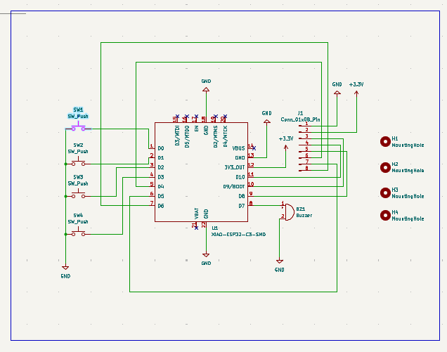
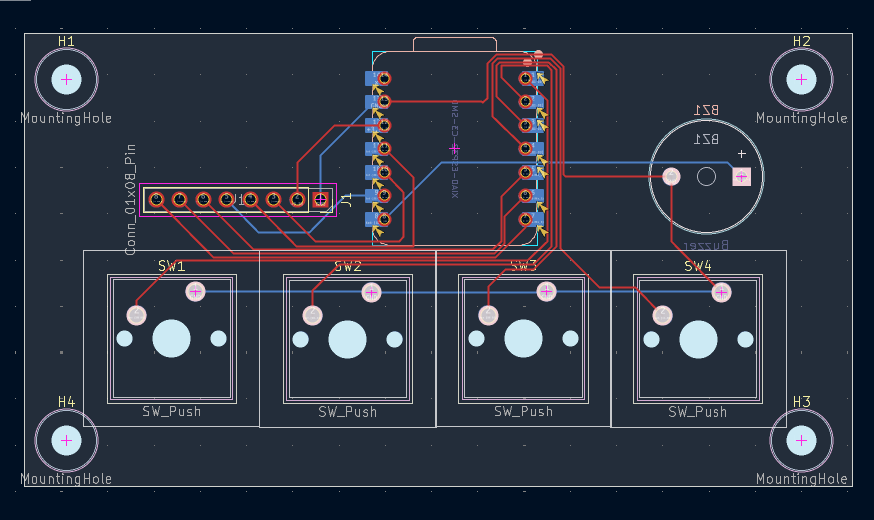
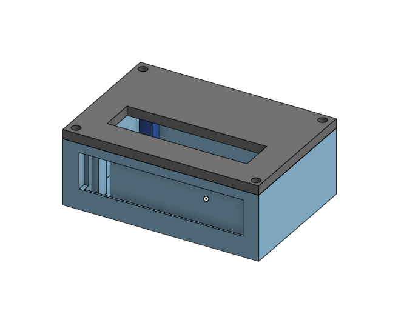
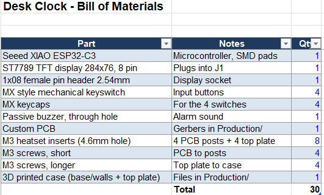

# Desk Clock

I wanted a little clock for my desk that wasn't just a phone screen, so I made one. It's a tiny wide TFT screen, four buttons and a buzzer, all running off an ESP32-C3. I drew the PCB, modelled the case and wrote the code myself.

## What it does

- shows the time on a 284x76 screen
- four buttons to set the time and the alarm
- buzzer beeps when the alarm goes off

## Schematic

The XIAO ESP32-C3 sits in the middle. The four switches and the buzzer each get their own pin, and the screen plugs into an 8 pin header on the left.

## PCB

Nothing fancy, just a 2 layer board with four mounting holes in the corners so it can screw down into the case.

## Case

The case is printed in two parts, a base with posts for the PCB and a top plate that screws on. The screen slides into a slot at the front, and there are small holes so the buzzer doesn't sound muffled.

## Firmware

Super simple. It's one Arduino sketch. To use it you need the ESP32 board package and the `Adafruit_GFX` and `Adafruit_ST7789` libraries (both in the library manager).

Setup does the boring stuff: turns the backlight on, starts the screen, flips it to landscape and clears it. After that, loop just redraws whatever is on screen once a second. Right now it shows a counter, which I swapped for the clock logic.

One thing to know: this screen has a weird resolution (284x76) so the sketch needs a small offset fix, it's commented in the code. If your pins are different, change the `#define` lines at the top.

## BOM

<!-- paste BOM screenshot here -->

